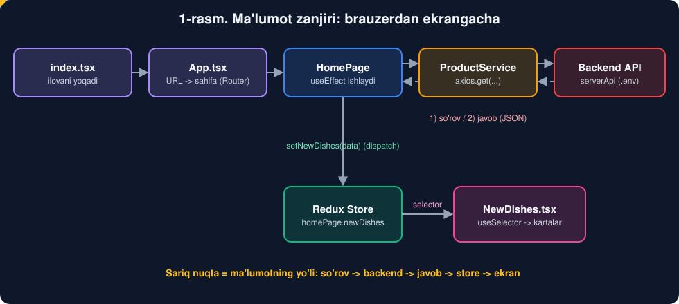
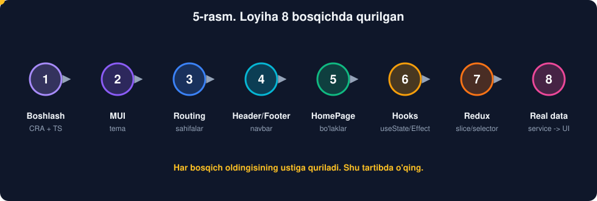
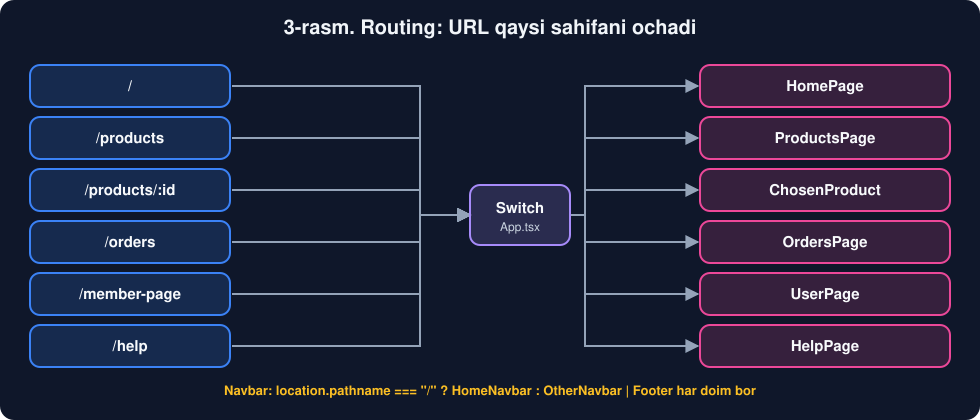
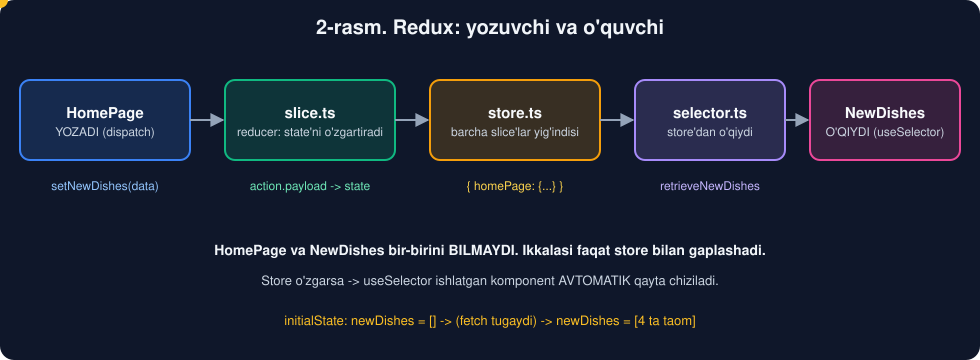
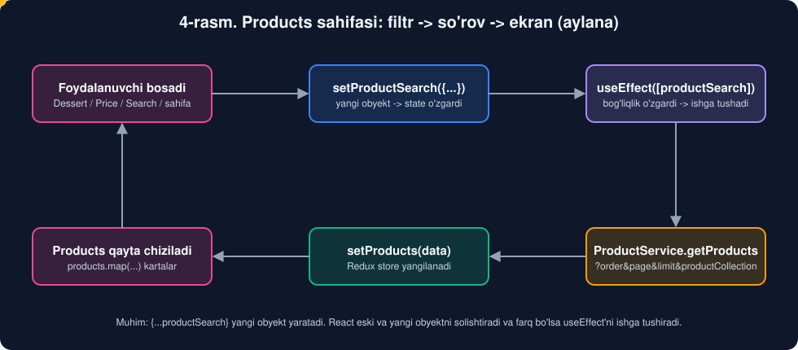

# Burak React: loyihani boshidan oxirigacha tushunish qo'llanmasi

Bu hujjat loyihani **git commit tartibida**, ya'ni qurilgan tartibda tushuntiradi. Har bir bosqichda quyidagilar bor:

- nima qurildi va nima uchun kerak
- qaysi fayllar bilan ishlandi
- kodning asosiy joyi va uning izohi
- o'zingiz sinab ko'rishingiz uchun mashq

> **Qanday o'qish kerak?** Birinchi marta o'qiyotgan bo'lsangiz, tepadan pastga ketma-ket o'qing.
> Rasmlar harakatlanadi. Sariq nuqta ma'lumot qaysi yo'ldan o'tayotganini ko'rsatadi.
> Ular GitHub'da va VS Code'ning Markdown Preview oynasida ishlaydi.

## Mundarija

0. [Loyiha nima va u qanday ishlaydi](#0-loyiha-nima-va-u-qanday-ishlaydi)
1. [Ishga tushirish](#1-ishga-tushirish)
2. [Papkalar xaritasi](#2-papkalar-xaritasi)
3. [Bosqichma-bosqich o'rganish](#3-bosqichma-bosqich-organish)
   - [1-bosqich. Loyihani boshlash](#1-bosqich-loyihani-boshlash)
   - [2-bosqich. MUI va tema](#2-bosqich-mui-va-tema)
   - [3-bosqich. Routing](#3-bosqich-routing-sahifalar-tizimi)
   - [4-bosqich. Header va Footer](#4-bosqich-header-va-footer)
   - [5-bosqich. HomePage bo'laklari](#5-bosqich-homepage-bolaklari-statik-dizayn)
   - [6-bosqich. Hooks mashqlari](#6-bosqich-class-component-va-hooks)
   - [7-bosqich. Redux Toolkit](#7-bosqich-redux-toolkit)
   - [8-bosqich. Haqiqiy ma'lumot](#8-bosqich-haqiqiy-malumot-service--redux--ekran)
4. [Products sahifasi: filtr, qidiruv, pagination](#4-products-sahifasi-filtr-qidiruv-pagination)
5. [ChosenProduct: bitta taom sahifasi](#5-chosenproduct-bitta-taom-sahifasi)
6. [Hozircha tugallanmagan qismlar](#6-hozircha-tugallanmagan-qismlar)
7. [Lug'at](#7-lugat)
8. [Mashqlar ro'yxati](#8-mashqlar-royxati)

---

## 0. Loyiha nima va u qanday ishlaydi

**Burak**, ya'ni restoran sayti, **frontend** (brauzerda ko'rinadigan qism) loyihasidir. Backend alohida loyiha. U ma'lumotlar bazasi bilan ishlaydi va frontend'ga JSON ko'rinishida ma'lumot beradi.

Frontend vazifalari:

1. Ekranda chiroyli sahifalarni ko'rsatish (React + MUI)
2. Backend'dan ma'lumot so'rash (axios)
3. Olingan ma'lumotni saqlash (Redux)
4. Saqlangan ma'lumotni ekranda chizish (komponentlar)

### Texnologiyalar

| Texnologiya | Nima uchun | Qayerda ko'rasiz |
|---|---|---|
| **React 18** | Sahifani komponentlarga bo'lib yozish | hamma `.tsx` fayllar |
| **TypeScript** | Ma'lumot turlarini oldindan belgilash, xatolarni erta topish | `lib/types`, `lib/enums` |
| **React Router v5** | URL ga qarab sahifa almashtirish | `App.tsx`, `productsPage/index.tsx` |
| **MUI (Material UI)** | Tayyor tugma, karta, tab, pagination | `MaterialTheme/`, har bir komponent |
| **Redux Toolkit** | Umumiy ombor (store) | `store.ts`, `slice.ts`, `selector.ts` |
| **axios** | Backend'ga HTTP so'rov | `services/*.ts` |
| **Swiper** | Rasmlar slayderi | `ChosenProduct.tsx` |
| **redux-logger** | Har bir Redux o'zgarishini Console'da ko'rsatish | `store.ts` |

### Katta rasm: ma'lumot qanday yuradi



Zanjirni so'z bilan aytsak (HomePage misolida):

1. Brauzer `index.tsx` ni ishga tushiradi. U Redux, tema va Router'ni ulab `<App />` ni chizadi.
2. `App.tsx` URL ga qaraydi. `/` bo'lsa `HomePage` ochiladi.
3. `HomePage` ekranga chiqishi bilan `useEffect` ishlaydi va `ProductService` orqali backend'dan taomlarni so'raydi.
4. Backend JSON qaytaradi. `HomePage` uni `setNewDishes(data)` bilan **Redux store**'ga yozadi.
5. `NewDishes` komponenti store'ni **selector** orqali kuzatib turadi. Store o'zgargan zahoti u qayta chizilib, kartalar paydo bo'ladi.

> Bu zanjirni bir marta tushunsangiz, loyihaning 80% ini tushungan bo'lasiz. Qolgan sahifalar xuddi shu naqshni takrorlaydi.

---

## 1. Ishga tushirish

```bash
npm install          # kutubxonalarni o'rnatish (bir marta)
npm start            # http://localhost:3000 da ochiladi
```

Loyiha ma'lumotni backend'dan oladi. Backend manzili **`.env`** faylida yoziladi:

```env
REACT_APP_API_URL=http://localhost:3003
```

(Port backend'ingiz qaysi portda ishlayotganiga bog'liq. `src/lib/config.ts` bu qiymatni `serverApi` nomi bilan olib, hamma joyda ishlatadi.)

**Backend ishlamasa nima bo'ladi?** Sahifa ochiladi, lekin ma'lumot bo'lmagani uchun "New products are not available!" kabi yozuvlar chiqadi. Console'da qizil xato ko'rinadi. Bu normal holat.

`.env` ni o'zgartirsangiz `npm start` ni **to'xtatib qayta ishga tushiring**. React `.env` ni faqat ishga tushganda o'qiydi.

---

## 2. Papkalar xaritasi

```
src/
├── index.tsx                  ← KIRISH NUQTASI: Provider, Theme, Router, App
├── app/
│   ├── App.tsx                ← Routing: URL → sahifa
│   ├── store.ts               ← Redux store (barcha slice'lar yig'iladi)
│   ├── hooks.ts               ← Tiplangan useAppDispatch / useAppSelector
│   ├── MaterialTheme/         ← MUI ranglari, shrift, soyalar
│   ├── components/            ← HAMMA sahifada ishlatiladigan bo'laklar
│   │   ├── headers/           ← HomeNavbar, OtherNavbar, Basket
│   │   ├── footer/
│   │   └── divider/
│   ├── screens/               ← SAHIFALAR (har birining o'z papkasi bor)
│   │   ├── homePage/          ← index.tsx + 6 bo'lak + slice.ts + selector.ts
│   │   ├── productsPage/      ← Products, ChosenProduct + slice.ts + selector.ts
│   │   ├── ordersPage/        ← Paused / Process / Finished
│   │   ├── userPage/
│   │   ├── helpPage/
│   │   └── Test.tsx           ← o'rganish uchun mashq (class component)
│   └── services/              ← Backend bilan gaplashuvchi class'lar
│       ├── ProductService.ts
│       └── MemberService.ts
├── lib/
│   ├── config.ts              ← serverApi, xabar matnlari
│   ├── enums/                 ← qat'iy qiymatlar (DISH, SALAD, ACTIVE...)
│   ├── types/                 ← ma'lumot shakllari (Product, Member, state)
│   └── data/                  ← statik matnlar (faq, plans, terms)
└── css/                       ← har sahifaning stili
```

**Qoida:** bitta sahifa = bitta papka. O'sha papkada sahifaning o'z `slice.ts` va `selector.ts` fayllari turadi.

---

## 3. Bosqichma-bosqich o'rganish



Har bosqichda kodni ko'rish uchun:

```bash
git show <commit-hash> --stat     # qaysi fayllar o'zgardi
git show <commit-hash>            # aynan nima o'zgardi
```

---

### 1-bosqich. Loyihani boshlash

**Commit'lar:** `c10c108` Initialize project using Create React App, `1dc34d1` fix: fixed problems

**Nima qilindi:** `create-react-app` bilan TypeScript'li React loyiha skeleti yaratildi.

**Asosiy fayllar:**

| Fayl | Vazifa |
|---|---|
| `package.json` | Loyiha kutubxonalari va `npm start` kabi buyruqlar |
| `public/index.html` | Yagona HTML. Ichida bo'sh `<div id="root">` bor |
| `src/index.tsx` | React'ni shu `root` ichiga "ulaydi" |
| `tsconfig.json` | TypeScript sozlamalari |

**Asosiy g'oya:** React'da sahifa bitta bo'sh `div` ichiga JavaScript bilan chiziladi. Shuning uchun u **SPA** (Single Page Application) deyiladi. Sahifalar orasida o'tganda brauzer qayta yuklanmaydi, faqat ekran ichi o'zgaradi.

**Mashq:** `src/index.tsx` da `<App />` ni vaqtincha `<h1>Salom</h1>` ga almashtiring. Brauzerda nima o'zgarishini ko'ring, keyin qaytaring.

---

### 2-bosqich. MUI va tema

**Commit'lar:** `4894d8b` MUI standard integration, `4f29565` MUI customized integration

**Nima qilindi:** MUI o'rnatildi, so'ng o'z rangingiz va shriftingiz bilan **tema** yaratildi.

**Fayllar:** `src/app/MaterialTheme/` (`index.ts`, `shadow.ts`, `typography.ts`, `styled.ts`)

```ts
// MaterialTheme/index.ts (qisqartirilgan)
primary:   { main: '#343434', contrastText: '#d7b586' },   // to'q kulrang tugma
secondary: { main: '#d7b586', contrastText: '#343434' },   // oltin rang tugma
```

Shuning uchun `<Button color="primary">` to'q, `<Button color="secondary">` esa oltin rangda chiqadi. Rangni har bir tugmaga alohida yozmaysiz, bitta joyda belgilaysiz.

**Tema qanday ulanadi?** `index.tsx` da:

```tsx
<Provider store={store}>            {/* Redux: hamma komponent store'ni ko'ra oladi */}
  <ThemeProvider theme={theme}>     {/* MUI: hamma komponent temani ko'ra oladi */}
    <CssBaseline />                 {/* brauzerlarning farqini tekislaydi */}
    <Router>                        {/* URL bilan ishlash imkonini beradi */}
      <App />
    </Router>
  </ThemeProvider>
</Provider>
```

Bu "qatlamlar" (**Provider** naqshi). Tashqi qatlam ichidagi hamma komponent uning imkoniyatidan foydalana oladi. `<App />` eng ichkarida turgani uchun Redux, tema va Router uchalasidan foydalana oladi.

**Mashq:** `MaterialTheme/index.ts` da `secondary.main` rangini `#d7b586` dan `#ff0000` ga o'zgartiring. Products sahifasidagi tugmalar rangi qanday o'zgaradi?

---

### 3-bosqich. Routing (sahifalar tizimi)

**Commit'lar:** `a8bd0a3` creat routing system, `2e7f442` develop screen based components

**Nima qilindi:** URL ga qarab qaysi sahifa ko'rsatilishi belgilandi.



```tsx
// App.tsx
<Switch>
  <Route path="/products"><ProductsPage /></Route>
  <Route path="/orders"><OrdersPage /></Route>
  <Route path="/member-page"><UserPage /></Route>
  <Route path="/help"><HelpPage /></Route>
  <Route path="/"><HomePage /></Route>     {/* ENG OXIRIDA */}
</Switch>
```

**Nima uchun `"/"` eng oxirida?** `Switch` yuqoridan pastga qarab **birinchi mos kelganini** ko'rsatadi. `"/"` yo'li `/products` ga ham mos keladi, chunki `/products` `/` bilan boshlanadi. Agar tepada tursa, hamma URL da HomePage chiqib qolardi.

**Ichma-ich routing (nested).** `productsPage/index.tsx` ning o'zida yana `Switch` bor:

```tsx
const products = useRouteMatch();          // products.path === "/products"

<Switch>
  <Route path={`${products.path}/:productId`}><ChosenProduct /></Route>   {/* /products/abc123 */}
  <Route path={`${products.path}`}><Products /></Route>                   {/* /products */}
</Switch>
```

Bu yerda ham **tartib muhim**: aniqroq yo'l (`/:productId`) tepada turadi.

`:productId` bu **o'zgaruvchan qism**. `/products/65ab...` ochilganda `ChosenProduct` ichida uni `useParams()` bilan olasiz.

**Sahifalar orasida o'tish:**

| Usul | Qayerda ishlatilgan | Izoh |
|---|---|---|
| `<NavLink to="/products">` | Navbar | bosiladigan havola, joriy sahifada `underline` klassi beradi |
| `history.push("/products/123")` | `Products.tsx` (`chooseDishHandler`) | kod ichidan o'tish |

**Mashq:** brauzerda qo'lda `/products`, `/orders`, `/help` yozib ko'ring. `App.tsx` dagi `console.log("location:", location)` Console'da nima chiqarishini kuzating.

---

### 4-bosqich. Header va Footer

**Commit'lar:** `a4eed2c`, `8a915e8`, `341f01c`, `41c6487`, `e46cb51`, `ceb7e7a`, `be4c91f`, `7034e51`

**Nima qilindi:** har sahifada ko'rinadigan yuqori menyu (navbar) va pastki qism (footer) yasaldi. Rasmlar va ikonkalar `public/` ga yuklandi.

**Ikki xil navbar:**

```tsx
// App.tsx
{location.pathname === "/" ? <HomeNavbar /> : <OtherNavbar />}
```

- `HomeNavbar`: bosh sahifada katta banner bilan
- `OtherNavbar`: qolgan sahifalarda ixcham menyu

Navbar `<Switch>` dan **tashqarida** turgani uchun u sahifa almashganda o'zgarmaydi, faqat yuqoridagi shart bo'yicha turi almashadi. `Footer` ham shunday.

**Login holati hozircha "soxta":**

```tsx
// OtherNavbar.tsx
const authMember = null;          // hozircha doim "kirmagan"
{authMember ? <Orders link /> : null}
```

`authMember` `null` bo'lgani uchun "Orders" va "My Page" havolalari ko'rinmaydi va "Login" tugmasi chiqadi. Keyingi bosqichda bu haqiqiy login bilan almashtiriladi.

**`Basket.tsx`:** savat ikonkasi va ochiladigan menyu. MUI `Menu` va `anchorEl` yordamida ishlaydi. `useState` bilan "ochiqmi?" holati saqlanadi.

---

### 5-bosqich. HomePage bo'laklari (statik dizayn)

**Commit'lar:** `f29d7bb`, `a348320`, `b53a416`, `3477267`, `65edefa`, `2ef392d`, `be4cc7b`, `b5faf2a`

**Nima qilindi:** bosh sahifa 6 ta kichik komponentga bo'lib yasaldi. Hozircha ma'lumot **qo'lda yozilgan** (statik).

```tsx
// homePage/index.tsx (return qismi)
<div className="homepage">
  <Statistics />        {/* raqamlar: yil, mijoz, ... */}
  <PopularDishes />     {/* ko'p ko'rilgan taomlar */}
  <NewDishes />         {/* yangi taomlar */}
  <Advertisement />     {/* reklama videosi: public/video/burak-ads.mp4 */}
  <ActiveUsers />       {/* eng faol foydalanuvchilar */}
  <Events />            {/* tadbirlar (Swiper slayder) */}
</div>
```

**Nima uchun bo'lib yozamiz?** Bitta katta fayl o'rniga har bir bo'lak o'z faylida. Topish, tahrirlash va qayta ishlatish oson.

Shu bosqichda `orders`, `user`, `product` sahifalarining bo'sh qobiqlari ham yaratildi.

**Mashq:** `NewDishes.tsx` dagi `"Fresh Menu"` yozuvini o'zgartiring. Qaysi joyda ko'rinishini toping.

---

### 6-bosqich. Class component va Hooks

**Commit'lar:** `6178093` create test class component, `aefc946` practice useState and useEffect hooks, `41c9624` comparing architectural designs

**Nima qilindi:** Redux'ga o'tishdan oldin React'ning ikki uslubi o'rganildi. Bu bosqich o'quv mashqi. Fayl: `screens/Test.tsx`.

Eski va yangi uslub solishtirmasi:

| Class component (eski) | Hooks (hozir ishlatiladigan) |
|---|---|
| `this.state = {...}` | `const [x, setX] = useState(...)` |
| `this.setState({...})` | `setX(yangiQiymat)` |
| `componentDidMount()` | `useEffect(() => {...}, [])` |
| `componentDidUpdate()` | `useEffect(() => {...}, [qiymat])` |
| `componentWillUnmount()` | `useEffect(() => { return () => {...} }, [])` |

**Loyihaning qolgan qismi faqat hooks bilan yozilgan.** Class component faqat tushunish uchun.

**`useEffect` ni eslab qolish usuli:**

```tsx
useEffect(() => {
  // 1) shu kod ishlaydi...
}, [a, b]);
// 2) ...faqat birinchi chizilishda VA a yoki b o'zgarganda.
// [] bo'sh bo'lsa: faqat BIR MARTA (sahifa ochilganda)
```

Backend'dan ma'lumot olish uchun aynan shu joy ishlatiladi: "sahifa ochilganda bir marta so'ra".

---

### 7-bosqich. Redux Toolkit

**Commit'lar:** `ae8f281` AppRootState and HomePage type integration, `bcad097` homePage Redux configuration, `e490a0f` slice and selector usage

**Muammo:** `HomePage` ma'lumotni oladi, lekin `NewDishes` uni ko'rsatishi kerak. Ular alohida komponentlar. Ma'lumotni ota-onadan bola-bolaga `props` bilan uzatish murakkab bo'lib ketadi.

**Yechim:** umumiy **ombor (store)**. Bir komponent omborga yozadi, boshqasi undan o'qiydi.



#### 7.1 Type: omborda nima bo'ladi?

```ts
// lib/types/screen.ts
export interface HomePageState {
  popularDishes: Product[];
  newDishes: Product[];
  topUsers: Member[];
}
export interface AppRootState {
  homePage: HomePageState;
  productsPage: ProductsPageState;
}
```

Bu faqat **shakl**. TypeScript'ga "ombor shunday ko'rinishda bo'ladi" deb aytadi.

#### 7.2 Slice: omborni o'zgartirish usullari

```ts
// homePage/slice.ts
const initialState: HomePageState = {
  popularDishes: [],      // boshida hammasi bo'sh
  newDishes: [],
  topUsers: [],
};

const homePageSlice = createSlice({
  name: "homePage",
  initialState,
  reducers: {
    setNewDishes: (state, action) => {
      state.newDishes = action.payload;      // payload = biz yuborgan ma'lumot
    },
    // ... setPopularDishes, setTopUsers
  },
});
```

`reducers` ichidagi har bir funksiya bitta "yozish buyrug'i". `createSlice` ularning **action'larini** (`setNewDishes` va h.k.) avtomatik yaratib beradi.

> Odatda `state.x = ...` yozish React'da xato. Lekin Redux Toolkit ichida **Immer** kutubxonasi bor. U buni "xavfsiz" nusxaga aylantirib beradi. Faqat `createSlice` ichida shunday yozish mumkin.

#### 7.3 Store: hamma slice'larni yig'ish

```ts
// app/store.ts
export const store = configureStore({
  middleware: (getDefaultMiddleware) => getDefaultMiddleware().concat(reduxLogger),
  reducer: {
    homePage: HomePageReducer,
    productsPage: ProductsPageReducer,
  },
});
```

`reducer` ichidagi kalitlar (`homePage`, `productsPage`) ombordagi "javonlar" nomi. Yangi sahifa uchun slice yozsangiz, shu yerga qo'shasiz.

`redux-logger`: brauzer Console'ida har bir action va state o'zgarishini ko'rsatadi. **O'rganish uchun eng foydali vosita.**

#### 7.4 Selector: ombordan o'qish

```ts
// homePage/selector.ts
const selectHomePage = (state: AppRootState) => state.homePage;

export const retrieveNewDishes = createSelector(
  selectHomePage,
  (HomePage) => HomePage.newDishes
);
```

"Omborning `homePage` javonidan `newDishes` ni ber" degan so'rov.

#### 7.5 Komponentda ishlatish: ikki tomon

**Yozuvchi** (`HomePage/index.tsx`):

```tsx
const actionDispatch = (dispatch: Dispatch) => ({
  setNewDishes: (data: Product[]) => dispatch(setNewDishes(data)),
});

const { setNewDishes } = actionDispatch(useDispatch());
// keyin:   setNewDishes(data)   → omborga yozildi
```

**O'quvchi** (`NewDishes.tsx`):

```tsx
const newDishesRetriever = createSelector(retrieveNewDishes, (newDishes) => ({ newDishes }));

const { newDishes } = useSelector(newDishesRetriever);   // ombordan oldi
// newDishes.map(...) bilan kartalarni chizadi
```

**Eslab qoling:** `dispatch` = yozish, `useSelector` = o'qish.

**Mashq (juda foydali):** `npm start` qiling, brauzerda F12 → Console. Sahifani yangilang. `redux-logger` chiqargan `action homePage/setNewDishes` qatorini toping va ustiga bosib `prev state` / `next state` ni solishtiring. `newDishes` `[]` dan `[4 ta obyekt]` ga o'zgarganini o'z ko'zingiz bilan ko'rasiz.

---

### 8-bosqich. Haqiqiy ma'lumot: Service → Redux → Ekran

**Commit'lar:** `e15563f` fresh menu, `e8f59aa` top users, `e0ae430` ProductsPage slice and selector, `a75cb36` retrieve data, `78d08b8` ChosenProduct logic

**Nima qilindi:** soxta ma'lumot olib tashlanib, hamma narsa backend'dan keladigan bo'ldi.

#### 8.1 Enum va Type: ma'lumot shakli

Backend'dan keladigan taom (`lib/types/product.ts`):

```ts
export interface Product {
  _id: string;
  productStatus: ProductStatus;          // PAUSE | PROCESS | DELETE
  productCollection: ProductCollection;  // DISH | SALAD | DESSERT | DRINK | OTHER
  productName: string;
  productPrice: number;
  productSize: ProductSize;              // SMALL | NORMAL | LARGE | SET
  productVolume: number;                 // ichimlik uchun (litr)
  productImages: string[];
  productViews: number;
  // ...
}
```

**Enum nima uchun kerak?** `"DISH"` ni qo'lda yozsangiz, `"DSIH"` deb xato qilishingiz mumkin. `ProductCollection.DISH` yozsangiz, xatoni TypeScript darhol ko'rsatadi.

#### 8.2 Service: backend bilan gaplashuvchi

```ts
// services/ProductService.ts
class ProductService {
  private readonly path: string;
  constructor() { this.path = serverApi; }          // .env dagi manzil

  public async getProducts(input: ProductInquiry): Promise<Product[]> {
    let url = `${this.path}/product/all/?order=${input.order}&page=${input.page}&limit=${input.limit}`;
    if (input.productCollection) url += `&productCollection=${input.productCollection}`;
    if (input.search)            url += `&search=${input.search}`;

    const result = await axios.get(url);
    return result.data;                              // backend javobi (JSON)
  }

  public async getProduct(productId: string): Promise<Product> { ... }   // bitta taom
}
```

Ikki sodda g'oya:

- Komponent `axios` nima ekanini bilmaydi. U faqat `new ProductService().getProducts(...)` deydi. Backend manzili o'zgarsa, faqat service'ni tuzatasiz.
- `async/await` bilan yozilgan, ya'ni "javob kelguncha kut, keyin davom et".

`MemberService`: xuddi shu uslubda `getTopUsers()` va `getRestaurant()` metodlari bor.

#### 8.3 HomePage: uchta so'rov bir vaqtda

```tsx
useEffect(() => {
  const product = new ProductService();
  const member  = new MemberService();

  product.getProducts({ page: 1, limit: 4, order: "productViews", productCollection: ProductCollection.DISH })
    .then((data) => setPopularDishes(data));      // ENG KO'P KO'RILGAN 4 ta taom

  product.getProducts({ page: 1, limit: 4, order: "createdAt", productCollection: ProductCollection.DISH })
    .then((data) => setNewDishes(data));          // ENG YANGI 4 ta taom

  member.getTopUsers()
    .then((data) => setTopUsers(data));           // ENG FAOL foydalanuvchilar
}, []);                                           // [] = faqat sahifa ochilganda bir marta
```

Faqat `order` o'zgarishiga e'tibor bering. Backend'ga "ko'rishlar bo'yicha" yoki "yaratilgan vaqt bo'yicha" saralashni aytadi. Shundan "Popular" va "New" farq qiladi.

#### 8.4 Komponent: ma'lumotni chizish

`NewDishes.tsx` dagi eng muhim 3 qator:

```tsx
const imagePath  = `${serverApi}/${product.productImages[0]}`;      // rasm backend'da turadi
const sizeVolume = product.productCollection === ProductCollection.DRINK
    ? product.productVolume + "l"                                   // ichimlik: "1.5l"
    : product.productSize + " size";                                // taom: "LARGE size"

{newDishes.length !== 0 ? newDishes.map(...kartalar...) : <Box>New products are not available!</Box>}
```

- `.map()` massivdagi har bir taom uchun bitta karta chizadi.
- `key={product._id}` React'ga har bir kartani ajratib turish uchun kerak.
- Ma'lumot yo'q bo'lsa (yoki hali kelmagan bo'lsa), "not available" yozuvi chiqadi. Shuning uchun `initialState` da `[]` (bo'sh massiv) turadi.

---

## 4. Products sahifasi: filtr, qidiruv, pagination

Bu loyihaning eng "jonli" sahifasi. Foydalanuvchi bosadi, ro'yxat o'zgaradi.



**Hamma narsa bitta state'da:**

```tsx
const [productSearch, setProductSearch] = useState<ProductInquiry>({
  page: 1,
  limit: 8,
  order: "createdAt",
  productCollection: ProductCollection.DISH,
  search: "",
});
```

**Bu state o'zgarsa, ro'yxat yangilanadi:**

```tsx
useEffect(() => {
  new ProductService().getProducts(productSearch).then((data) => setProducts(data));
}, [productSearch]);        // ← productSearch o'zgarganda qayta ishlaydi
```

**Tugmalar faqat state'ni o'zgartiradi.** Qolganini `useEffect` o'zi qiladi:

```tsx
const searchCollectionHandler = (collection: ProductCollection) => {
  productSearch.page = 1;                       // yangi kategoriyada 1-sahifadan boshlaymiz
  productSearch.productCollection = collection;
  setProductSearch({ ...productSearch });       // YANGI obyekt yaratib beramiz
};
```

**Nima uchun `{ ...productSearch }`?** React state o'zgarganini **obyektning manzili** o'zgarganidan biladi. `{ ...productSearch }` eski obyektning yangi nusxasini yaratadi. Shunda `useEffect` "o'zgarish bo'ldi" deb ishga tushadi.

> Bu yerda avval `productSearch.page = 1` deb eski obyektni to'g'ridan-to'g'ri o'zgartirilgan. Ishlaydi, lekin React'da tavsiya qilinadigan usul: `setProductSearch({ ...productSearch, page: 1, productCollection: collection })`. Keyin xohlasangiz shunday tozalash mumkin.

**Qidiruv:** input `searchText` da saqlanadi. Enter yoki "Search" bosilganda `productSearch.search = searchText` bo'ladi. Input tozalansa (`""`), qidiruv avtomatik olib tashlanadi (ikkinchi `useEffect`).

**Pagination hiylasi:** backend umumiy sahifalar sonini bermaydi. Shuning uchun:

```tsx
count={ products.length !== 0 ? productSearch.page + 1 : productSearch.page }
```

Hozirgi sahifada taom bo'lsa, "keyingi sahifa ham bo'lishi mumkin" deb bitta ortiq ko'rsatadi. Taom bo'lmasa, to'xtaydi.

**Taomni bosganda:**

```tsx
history.push(`/products/${id}`);     // → ChosenProduct sahifasi ochiladi
```

---

## 5. ChosenProduct: bitta taom sahifasi

URL: `/products/:productId`

```tsx
const { productId } = useParams<{ productId: string }>();   // URL dagi :productId ni olish

useEffect(() => {
  new ProductService().getProduct(productId).then((data) => setChosenProduct(data));   // taomni olish
  new MemberService().getRestaurant().then((data) => setRestaurant(data));              // restoran ma'lumoti
}, []);

if (!chosenProduct) return null;       // ma'lumot kelguncha hech narsa chizma
```

Bu yerda `productsPage` slice'ining uch maydoni ishlatiladi:

| Slice maydoni | Kim yozadi | Kim o'qiydi |
|---|---|---|
| `products` | `Products.tsx` | `Products.tsx` |
| `chosenProduct` | `ChosenProduct.tsx` | `ChosenProduct.tsx` |
| `restaurant` | `ChosenProduct.tsx` | `ChosenProduct.tsx` |

`Swiper` kutubxonasi taom rasmlarini surib ko'riladigan slayder qiladi (`productImages` massivi bo'yicha).

---

## 6. Hozircha tugallanmagan qismlar

Loyihaning keyingi bosqichlarida qilinadigan ishlar:

| Narsa | Holat | Izoh |
|---|---|---|
| Login / Signup | ❌ yo'q | `authMember = null` qo'lda yozilgan (`OtherNavbar`, `Basket`) |
| Savat (Basket) | ⚠️ faqat dizayn | Taom qo'shish mantig'i yo'q |
| Orders sahifasi | ⚠️ statik | Tab'lar bor, lekin buyurtma ma'lumoti backend'dan kelmaydi |
| User sahifasi / Settings | ⚠️ statik | Profil tahrirlash yo'q |
| `Test.tsx` | ℹ️ o'quv fayli | Productionda kerak emas |
| `console.log` lar | ℹ️ ko'p | Rivojlanish uchun, keyin tozalash mumkin |
| `alert(collection)` | ℹ️ `Products.tsx` | Tugmalarni sinash uchun qoldirilgan debug |
| `.env` | ⚠️ gitda turibdi | Sir ma'lumot (kalit, parol) yozmang. Hozircha faqat API manzili bor |

---

## 7. Lug'at

| Atama | Oddiy tushuntirish |
|---|---|
| **Component** | Sahifaning qayta ishlatiladigan bo'lagi (`NewDishes`, `Basket`) |
| **State** | Komponent ichida saqlanadigan, o'zgarsa ekran yangilanadigan ma'lumot (`useState`) |
| **Props** | Ota komponentdan bola komponentga berilgan ma'lumot |
| **Hook** | `use...` bilan boshlanadigan funksiya (`useState`, `useEffect`, `useSelector`) |
| **Store** | Redux umumiy ombori |
| **Slice** | Omborning bitta "javoni": boshlang'ich holat va o'zgartirish usullari |
| **Reducer** | Slice ichidagi, omborni o'zgartiradigan funksiya |
| **Action** | "Omborga shuni yoz" degan buyruq (`setNewDishes(data)`) |
| **Dispatch** | Action'ni omborga yuborish |
| **Payload** | Action ichidagi ma'lumot (`action.payload`) |
| **Selector** | Ombordan kerakli qismni o'qiydigan funksiya |
| **Service** | Backend bilan gaplashadigan class (axios) |
| **Enum** | Oldindan belgilangan qiymatlar ro'yxati (`DISH`, `SALAD`) |
| **Interface** | TypeScript'da ma'lumot shakli ta'rifi |
| **Router** | URL ga qarab sahifa almashtiruvchi |
| **SPA** | Bitta HTML sahifa, ichi JavaScript bilan almashadigan sayt |

---

## 8. Mashqlar ro'yxati

Tushunganingizni tekshirish uchun, osondan qiyinga:

1. **(Oson)** `NewDishes.tsx` da `"Fresh Menu"` ni o'zgartiring.
2. **(Oson)** `HomePage/index.tsx` da `limit: 4` ni `limit: 2` qiling. Nechta karta chiqadi?
3. **(Oson)** Console'dagi `redux-logger` natijasida `setNewDishes` action'ini toping.
4. **(O'rta)** `PopularDishes.tsx` ni oching va `NewDishes.tsx` bilan solishtiring. Nima bir xil, nima farq qiladi? (Ko'rsatma: `retrievePopularDishes` va `order`.)
5. **(O'rta)** Products sahifasida "Drink" bosganda `productSearch` qanday o'zgarishini `console.log(productSearch)` bilan ko'ring.
6. **(O'rta)** `alert(collection)` ni olib tashlang. Tugmalar baribir ishlaydimi?
7. **(Qiyin)** `searchCollectionHandler` ni `{ ...productSearch, page: 1, productCollection: collection }` uslubiga o'tkazing, ya'ni obyektni o'zgartirmasdan.
8. **(Qiyin)** Yangi slice yarating: `ordersPage` uchun `slice.ts`, `selector.ts`, `AppRootState` ga qo'shing va `store.ts` ga ulang. Bu 7-bosqich naqshining takrorlanishi.

---

> **Eslatma:** bu hujjatdagi rasmlar `docs/img/` papkasida (animatsiyali SVG). Kod o'zgarganda
> (masalan yangi sahifa qo'shilganda) ularni yangilab turing. Loyihaning o'z reklama videosi
> `public/video/burak-ads.mp4`. U `Advertisement.tsx` komponentida ishlatiladi.
